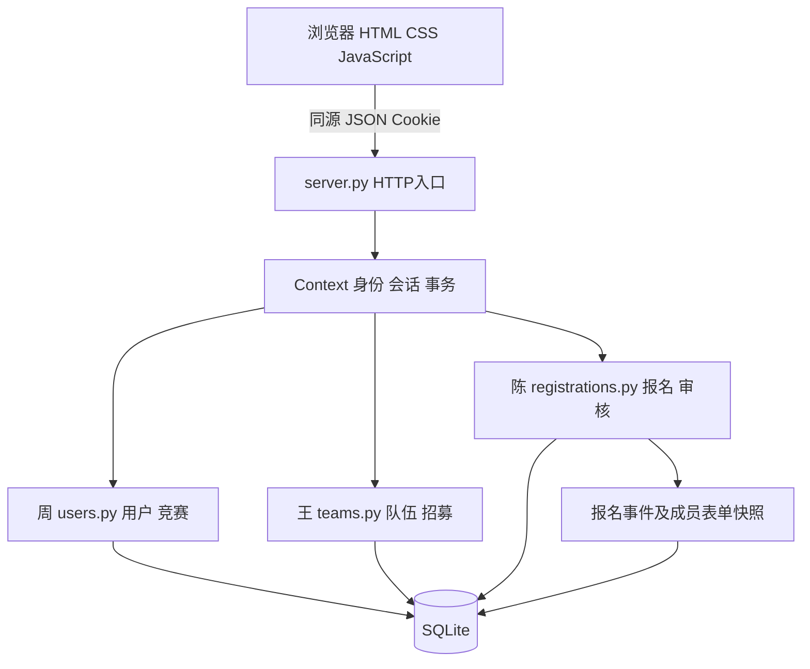

# 架构设计与决策参考稿

统一载体为大学生竞赛信息与组队管理系统 v0.2。以下A、B和书记员内容是本轮AI提供的方案草稿及工程比较，未冒充三位学生已经召开评审会。学生最终裁决及真实截图需要本人补充。

## 1 输入上下文

功能需求和质量标准见SRS。质量驱动包括报名隐私、一致性、可维护性和小样本本机响应；开发约束包括三人六模块、Python标准库、SQLite、单机浏览器演示、无需额外服务。关键易变点为竞赛人数/截止政策、成员及审批规则、审核历史与导出格式。非目标为互联网高并发和外部平台集成。

## 2 评审员A草案

风格：按业务能力拆分的微服务及事件协作。A只从可修改性和信息隐藏出发，建议用户竞赛、队伍招募、报名审核分别部署和管理数据库，使用网关汇总接口，报名通过领域接口确认队伍资格，历史和通知通过事件解耦。独立服务可以隔离演化和故障，但跨服务资格检查不能仅靠异步事件保证实时唯一性。

| 组件 | 职责 | 依赖与通信 | 隔离的易变点 |
| --- | --- | --- | --- |
| 网关 | 同源入口和身份转发 | 同步HTTP | 前端接口形态 |
| 用户竞赛服务 | 身份及竞赛规则 | 独立数据库，同步查询 | 密码策略、竞赛字段 |
| 队伍服务 | 成员归属与容量 | 独立数据库，资格接口 | 入队/退出政策 |
| 报名服务 | 提交及审核历史 | 资格确认接口、独立数据库 | 状态及表单版本 |
| 事件通道 | 向历史等消费者分发结果 | 异步事件，需去重 | 扩展订阅逻辑 |

## 3 评审员B草案

风格：共享事务数据库的模块化单体。B严格受三人、课程工期和免安装依赖约束，采用原生HTML/CSS/JS、HTTP入口、三个业务模块和SQLite；职责拆分留在进程内，不增加网关或消息服务。统一事务可以直接保护跨模块的队伍与报名规则，代价是业务模块仍依赖关系表和SQLite，不能声称已完全采用仓储抽象。

| 组件 | 职责 | 依赖与通信 | 隔离的易变点 |
| --- | --- | --- | --- |
| static界面 | 展示、交互、错误和确认 | 同源fetch调用JSON API | 页面及输入体验 |
| server入口 | HTTP、Cookie、数据库连接、写事务 | Context传入模块 | 会话/协议/事务 |
| users模块 | 用户和竞赛 | SQL及Context身份接口 | 密码和竞赛规则 |
| teams模块 | 队伍和招募 | 同事务共享SQLite | 容量和归属规则 |
| registrations模块 | 报名、审核、历史与导出 | 同事务共享SQLite | 表单和历史政策 |

## 4 中立书记员的分歧清单

| 分歧 | A的结构 | B的结构 | 原则及分歧原因 |
| --- | --- | --- | --- |
| 部署与模块边界 | 服务边界隔离业务 | 进程内按文件划分 | 模块化与关注点分离均可实现，隔离强度不同 |
| 数据封装 | 各服务拥有数据库 | 共库，由业务模块执行SQL | 信息隐藏程度不同，B结构存在表耦合 |
| 跨模块一致性 | 同步确认和补偿/幂等 | 一个SQLite写事务 | 解耦与原子一致性边界不同 |
| 历史扩展 | 事件通道订阅 | 同事务写历史表 | 抽象与依赖方向不同，交付组件数量不同 |

书记员只描述结构差异，不据此推荐方案。上表为AI结构化输出参考。

## 5 建议裁决及最终实现

建议以B为基底，从A借用“把易变身份细节隐藏在接口之后”和“明确历史事件”的思想，不引入服务拆分。理由是成员唯一性、容量、报名锁定跨越多个模块，一次写事务可降低竞态和补偿成本；独立部署目前没有相应需求。

| 决策 | 本次辅助实现状态 | 设计原则及理由 |
| --- | --- | --- |
| 标准库模块化单体作为基底 | 【AI-Adopted】 | 关注点分离，减少部署组件，符合现有约束 |
| 不部署网关、独立服务库、消息通道 | 【Rejected】 | 现阶段跨服务一致性及运维代价超过收益，不是否认服务架构的普遍价值 |
| 通过Context撤销同用户其他会话 | 【Revised】 | 信息隐藏：用户模块不导入server全局会话字典，降低循环依赖 |
| 报名与历史在一个事务写入，名单采用快照 | 【Revised】 | 新增关键精化：避免状态变更无历史、个人资料改写已提交事实 |
| 旧记录用migrated现状事件迁移 | 【Revised】 | 不生成无法证明的历史；迁移可重复执行，数据完整性优先 |

上述标记记录本次AI辅助实现的技术取舍，不等于学生本人已经独立审定。学生需逐项签认、改写理由或否决，保存真实裁决。

业务仅需Python3.10+与现代浏览器。启动自动建表、幂等迁移并补缺演示账号，不清空数据；--db选择独立库。SQLite backup API提供一致性备份，恢复与操作步骤见验收指南。

局限：未实现TLS、登录限流、分布式会话或海量分页，仅面向本机演示。前端仍为单个app.js，复杂度增加后再按业务拆分。

图2-1 最终高层架构。模块之间通过HTTP层传入的上下文共享事务，图中Context不是独立服务。密码使用PBKDF2加盐哈希；8小时会话在进程内；服务仅监听127.0.0.1。

## 6 数据设计

| 表 | 主键与关联 | 保存内容及约束 |
| --- | --- | --- |
| users | id；username唯一 | 用户公开资料、哈希和角色 |
| competitions | id | 标题、类别、规则、上架状态 |
| teams | id；competition_id和captain_id外键 | 队伍资料与创建时间 |
| team_members | team_id,user_id联合主键 | 成员关系；同竞赛唯一性由事务内规则校验 |
| applications | id；team_id,user_id唯一 | 申请说明和当前状态；撤回删除待审记录，不是完整审计日志 |
| registrations | id；team_id唯一 | 联系人、说明、当前状态与审核意见 |
| registration_history | id；registration_id外键和索引 | 事件、操作者姓名、时间、当时表单和成员JSON快照 |

外键在每次连接启用；普通写请求先BEGIN IMMEDIATE，事务提交前序列化资格判断和写入。SQLite通过单写者约束保证当前服务的写入顺序；这限制了扩展性，不能推导为支持分布式多写。参数化SQL避免把用户文本当SQL执行；JSON响应和前端HTML转义分层处理数据。

## 7 核心过程

审批过程为身份→队长→未报名→待审→开放/容量/归属复查→成员与申请同事务写入。报名过程为队长→开放→人数→表单→当前记录与历史同事务写入。审核过程为管理员→待审→意见→当前状态与历史同事务写入；失败整体回滚。具体状态图及输入输出在陈的模块文档中。
