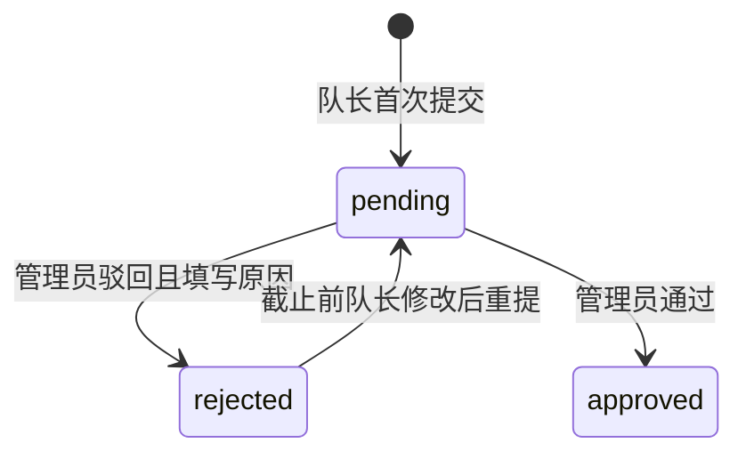

# 陈负责的报名提交与审核查询模块

版本：v0.2。整理日期：2026-11-03。责任边界：队长报名、报名审核、结果查询、报名过程留痕与授权导出。用户身份由周的用户模块提供；队伍与成员管理由王的队伍模块提供。

本文件是本次 AI 辅助开发任务的模块交付说明。模块实现及自动化测试已完成；陈本人仍须阅读代码、亲自演示、核对需求取舍并补充个人实际工作记录。本文不作为学生独立完成需求初稿、独立编码或完成多轮需求对话的证明。

## 两个功能模块及验收需求

| 需求 ID | 功能模块 | 可验证的要求 | 验收依据 |
| --- | --- | --- | --- |
| FR-R01 | 报名提交管理 | 仅本队队长可提交；竞赛须上架且未截止；实际人数符合最少及最多人数；联系人、电话、说明须通过格式与长度校验；待审或已通过记录不得重复提交 | 原有 `test_system.SystemTest.test_02_complete_workflow`；`test_03_deadline_capacity_and_unpublish` |
| FR-R02 | 报名提交管理 | 首次提交保存成员姓名和专业快照；驳回后截止前可修改联系人和说明重提，沿用首次名单快照；每次提交独立保留表单版本 | `test_chen.ChenRegistrationTest.test_history_full_state_cycle_and_failed_reviews`；`test_member_and_actor_snapshots_survive_profile_changes` |
| FR-V01 | 审核与查询 | 仅管理员能审核待审记录；驳回必须填原因；队员与管理员可查询状态、意见及完整历史，其他学生和访客不得读取 | 原有完整流程测试；`test_history_full_state_cycle_and_failed_reviews`；`test_history_and_export_access_control` |
| FR-V02 | 审核与查询 | 授权用户可导出有权查看的记录；管理员导出全部，学生仅导出所在队伍；中文、逗号和换行按 CSV 格式保存，公式前缀安全转义；数据库原始值保持不变 | `test_history_and_export_access_control`；`test_export_formula_escaping_and_csv_quoting` |

这些要求由现有范围及本次 AI 辅助完善建议形成，作为工程基线待本人审阅。涉及新增历史和导出的建议可在学生实际确认后标注【AI-Adopted】；若学生修改规则，应记录【Revised】及理由，不能直接把本说明当作已经发生的学生裁决。

## 数据输入与输出

报名输入包括 `team_id`、`contact_name`、`contact_phone`、`statement`。姓名最长 40 字，电话字段最长 30 字，电话允许加号、数字、括号、空格、短横线且数字数量在 6 至 20 位，参赛说明最长 2000 字。电话只做格式校验，不校验号码归属或真实性。示例号码 `13800000000` 仅为演示。

报名成功返回 `registration_id`、`status=pending` 和中文操作结果。无权读取返回 HTTP 403；业务规则不满足返回 HTTP 400。审核输入为 `status=approved/rejected` 及最长 1000 字的 `review_note`。通过时说明可为空，驳回时必须填写。

查询返回当前表单、队伍名称、竞赛名称、冻结名单 `members` 和升序排列的 `history`。每个历史项含事件 ID、报名 ID、事件类型、结果状态、操作者 ID 与姓名快照、发生时间、审核意见、联系人、电话、参赛说明、成员快照。

## 状态与过程设计



审核结果属于管理人员的判断，报名截止后仍可审核此前已提交的待审记录。截止后队长不能首次提交或重提。已通过记录无撤销和重新审核入口，本阶段不扩大状态集合。

报名写入和历史写入共同依赖 HTTP 层的 `BEGIN IMMEDIATE` 写事务。任一步失败均回滚，避免当前状态已经变更而历史未保存。已有报名的队伍及成员持续锁定，包括已驳回状态；这样重提只改表单，不在审核期间悄悄更换名单。

首次提交调用 `_members()` 获取名单；`_history()` 保存为 JSON 文本。从此查询、审核及重提沿用该快照。用户后来修改姓名或专业不会修改历史；操作者姓名也单独保存，因此历史显示当时的姓名。报名记录列表中队伍名、竞赛名仍取当前基础数据，并未承诺冻结竞赛简介或标题。

## 接口清单

| 方法和路径 | 调用者 | 输入或输出 | 主要实现 |
| --- | --- | --- | --- |
| `POST /api/registrations` | 本队队长 | 首次提交或驳回后重提表单 | `_submit` |
| `GET /api/registrations` | 登录用户 | 管理员全部记录；学生本队记录，含历史 | `_list_registrations` |
| `POST /api/registrations/{id}/review` | 管理员 | 通过或驳回及意见 | `_review` |
| `GET /api/registrations/export` | 登录用户 | JSON：`filename` 与 `content` | `_export` |

`export` 返回的 `content` 是带 UTF-8 BOM 的 CSV 文本，由前端生成下载。CSV 列依次为报名编号、竞赛、队伍、联系人、联系电话、参赛说明、成员、状态、审核意见、提交时间、更新时间。导出当前记录，不导出全部历史版本。含公式风险前缀的单元格添加英文单引号；正常的逗号、双引号和换行由标准库 `csv.writer` 处理。

授权统一在 `_list_registrations()` 执行，再由 `_export()` 复用查询结果。筛选依据来自服务端登录会话，而非客户端传入的用户 ID。历史与联系人拥有同样的访问范围，不另设公开历史接口。

## 数据设计与升级

原表 `registrations` 存当前报名状态，一队一条报名记录。新增表 `registration_history` 存事件快照，多条历史关联一条报名，使用 `(registration_id, id)` 索引支持按记录读取时间线。事件类型为 `submitted`、`resubmitted`、`approved`、`rejected`，旧库升级另用 `migrated`。

`initialize(db)` 由统一初始化入口调用，可重复执行。对升级前没有历史的报名，仅保存一次迁移时的可证实现状。旧数据原审核人未知，`actor_id` 为空，说明明确显示“原审核人未知”；成员快照以迁移时资料为准。不会把一个旧的“已通过”状态伪造为曾记录到的提交与通过两次事件，也无法恢复升级前未保存的表单版本。

## 本次实际测试记录

执行命令：

```powershell
python -m unittest discover -s tests -p test_chen.py -v
```

2026-11-03 实际执行结果：5 组测试通过，`Ran 5 tests`、`OK`。测试经真实本地 HTTP 请求访问临时数据库，不修改 `data/app.db`。

| 测试方法 | 重点 | 已观察结果 |
| --- | --- | --- |
| `test_history_full_state_cycle_and_failed_reviews` | 提交、驳回、重提、通过的四个事件；越权审核、缺原因、重复审核不产生事件；SQLite 中持久保存 | 通过 |
| `test_member_and_actor_snapshots_survive_profile_changes` | 更改队长姓名和专业后名单及旧操作者姓名不变，新重提记录使用当时操作者姓名 | 通过 |
| `test_history_and_export_access_control` | 访客禁止导出；无关学生无他队历史和电话；学生仅导出本队，管理员可见两队 | 通过 |
| `test_export_formula_escaping_and_csv_quoting` | `@`、`+`、`=` 前缀安全转换；逗号及多行说明完整往返解析；原值不被改写 | 通过 |
| `test_legacy_migration_is_idempotent_and_honest` | 对无历史的已通过旧记录重复初始化只得到一个迁移事件，审核人保持未知 | 通过 |

首次测试发现历史插入 SQL 的列数与占位符不符，已修复后重新执行通过。第二次发现测试中数据库连接未显式关闭导致 Windows 无法清理临时库，已用 `contextlib.closing` 修复后重新执行通过。这些是真实发现的缺陷，不应在报告中写成“首次测试全部通过”。全项目集成结果以统一验收测试记录为准。

## 陈本人交付前复核

- 阅读 `_submit`、`_review`、`_history` 和 `_list_registrations`，解释当前记录与历史快照为何分别保存。
- 亲自完成一次三人组队报名、驳回补充、重新提交、审核通过，保留真实截图。
- 使用第三个无关学生账号验证无法查看联系人及报名历史，用管理员和学生分别导出并核对范围。
- 说明报名后为什么不允许移除成员、截止后为什么不能重提、旧库为何不能恢复未知审核人。
- 补充自己实际拟定的需求初稿、需求对话、裁决理由及课程反思；复核后在个人工作清单中如实填写 AI 辅助范围与个人完成内容。

本次 AI 辅助范围包括代码修改、测试设计与执行、模块文档整理。尚未完成的学生本人任务、屏幕阅读器人工测试、网络教学平台提交，不记为已完成。
