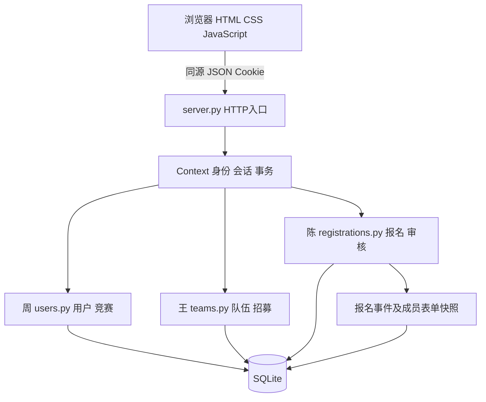

# 大学生竞赛信息与组队管理系统课程大作业工程参考稿

状态：AI辅助工程参考稿，个人独立初稿、真实对话、最终裁决、个人信息和反思待本人补齐。

# 第一章 需求分析专项

# 大学生竞赛信息与组队管理系统需求规格说明

版本 v0.2，基线日期 2026-11-03。本规格整理当前可实现、可验证的课程项目范围，供三位成员审定；它是 AI 辅助工程参考稿，不能倒填为“未借助AI的自主初稿”。已有范围来自原 README 和分工记录，新增规则及交互由本次辅助开发提出并实现。

## 1 项目边界与涉众

系统解决学生查找竞赛、寻找队友和校内报名审核的信息分散问题。三个业务板块为用户与竞赛、队伍与招募、报名与审核。学生可以成为特定队伍的队长，队长不是全局账号角色；管理员维护竞赛和审核报名；访客可以浏览上架竞赛和公开队伍；教师通过演示、源码、文档和测试评价项目。

不包含智能匹配、聊天推送、附件上传、外部官网报名、成果档案、学校统一认证、互联网公开部署。官方链接仅作跳转，演示竞赛均为虚构数据。现阶段采用本机服务、Python标准库和SQLite，三名成员每人负责两个模块。

| 责任人 | 模块一 | 模块二 | 贡献边界 |
| --- | --- | --- | --- |
| 周 | 用户与权限 | 竞赛信息管理 | 用户身份、资料、密码、竞赛基础规则；统筹接口，不代替另两人本人工作 |
| 王 | 队伍管理 | 招募申请管理 | 队伍资料、成员关系、申请和审批；不处理正式报名 |
| 陈 | 报名提交管理 | 审核与查询 | 表单、状态、历史、隐私和授权导出；不管理用户与招募 |

## 2 功能需求

| ID | 功能 | 可验收要求 | 优先级 |
| --- | --- | --- | --- |
| FR-U01 | 注册登录及资料 | 公开注册固定学生角色；正确密码建立8小时会话，退出立即失效；仅修改允许字段；响应不包含密码哈希 | 高 |
| FR-U02 | 密码维护 | 正确原密码及8至128位不同新密码才可修改；保留当前登录，其他同账号会话失效；失败不改变密码 | 中 |
| FR-C01 | 竞赛维护检索 | 访客仅见上架竞赛；管理员发布、编辑、下架；关键词与精确分类可组合；链接限定HTTP/HTTPS | 高 |
| FR-C02 | 资格规则保护 | 1≤最少≤最多≤20；最多人数不能低于现有队伍人数；已有任何报名后锁定上下限和截止时间 | 高 |
| FR-T01 | 队伍创建 | 仅学生在竞赛开放时创建；队长自动加入；每人同竞赛最多属于一队；创建队伍自动拒绝其余待审申请 | 高 |
| FR-T02 | 队伍及成员管理 | 队长编辑/解散/移除非队长成员；非队长可自行退出；第一次报名后队伍与名单锁定，驳回也不解锁 | 高 |
| FR-A01 | 申请与撤回 | 仅学生向开放、未满且未报名的队伍申请；重复待审/批准申请拒绝；本人可撤回待审申请并重新申请 | 高 |
| FR-A02 | 队长审批 | 仅本队队长处理待审申请；批准时再次检查人数与同竞赛归属；成功后拒绝其余同竞赛待审申请；并发不超员不跨队 | 高 |
| FR-R01 | 报名提交 | 仅队长；竞赛上架且未截止；人数合规；联系人、电话、说明合法；一队一条当前记录，待审/通过不可重复提交 | 高 |
| FR-R02 | 驳回重提与快照 | 驳回后截止前可修改表单重提，保留原名单快照；个人资料修改不改写既有报名事实 | 高 |
| FR-V01 | 审核与历史 | 仅管理员审核待审记录；驳回必须说明；提交、驳回、重提、通过每次留痕；旧库仅建立诚实现状迁移事件 | 高 |
| FR-V02 | 查询与导出 | 管理员可查全部，学生仅本队；历史与电话同样隔离；CSV只导出有权记录，中文可读并安全处理公式前缀 | 中 |

截止为日期时包括当日全天；精确时间按其时区比较，无时区时间按服务端本地时间解释，课堂机器应使用中国标准时间。已下架竞赛的队伍仅成员、本人有待审申请的学生和管理员可见。截止或下架后允许未报名队伍清理成员或撤回意愿，禁止新增成员。管理员可以审核截止前已经提交的报名。

## 3 质量需求与可测试标准

| ID | 属性 | 验收标准与条件 | 验证方式 |
| --- | --- | --- | --- |
| NFR-01 | 权限及隐私 | 匿名访问报名/导出返回403；学生不能审核或维护竞赛；无关学生响应不含他队联系人、说明、历史 | 集成测试，按不同Cookie实际请求 |
| NFR-02 | 一致性 | 两人争最后一个位置仅一人成功；两队抢同一学生仅一队成功；失败请求无部分写入 | 并发HTTP测试、数据库关联及人数断言 |
| NFR-03 | 持久性 | 业务事务提交后重新连接、重复初始化不丢数据；SQLite完整性及外键检查通过 | 数据库重开、初始化幂等测试；人工停止重启演示 |
| NFR-04 | 本地响应 | 当前小样本演示数据、本机5并发40次竞赛列表请求，P95小于2秒；不承诺广域网和大数据量表现 | 保存实际performance.json，列明环境和样本 |
| NFR-05 | 输入与输出安全 | 非JSON对象、损坏JSON、超长字段和非法日期返回400；跨站Origin写请求被拒；用户内容HTML转义；CSV风险前缀转义 | HTTP异常测试、真实浏览器检查和CSV回读测试 |
| NFR-06 | 基础可用性 | 核心界面在390像素宽度无横向滚动；字段有名称；弹窗有标题与键盘焦点；状态文字不只依赖颜色；破坏性操作二次确认 | 浏览器自动化、CSS检查；屏幕阅读器效果待人工实测 |
| NFR-07 | 可维护性 | 六模块责任映射至三业务文件，HTTP层统一事务；每项核心需求关联设计、实现和测试 | RTM及源码审查，不以测试数量充当覆盖率 |

## 4 核心用例一 组队审批

参与者：队长周、申请者王/陈。前置条件：已登录学生、上架未截止的竞赛、申请者同竞赛尚未入队。触发：周创建队伍，王申请加入。

主流程：周填写竞赛、名称、介绍和招募要求，系统创建队伍并自动加入周；王提交申请说明；周读取本队待审申请并同意；系统在同一写事务中再次验证队伍未报名、未满员、王未加入其他队伍，加入成员并更新申请状态，同时拒绝王同竞赛其他待审申请。结果：成员人数加一，王看到已加入。

异常：非队长审批失败；重复申请失败；过期、下架、超员、已报名失败；并发仅一个有效结果。可选恢复：待审时王可撤回；入队后可退出、被移除后可重申。队长只能解散未报名队伍，不能自行退出留下无队长队伍。

## 5 核心用例二 报名与审核

参与者：队长周、管理员、本队队员。前置条件：队伍人数符合规则、上架未截止。触发：队长在队伍详情提交报名。

主流程：填写联系人、电话和说明；系统验证权限、人数和截止时间，保存当前记录及成员/表单快照，状态待审核；管理员核对后通过，系统保存审核事件；队员查看相同结果和历史。结果：名单锁定，记录持久保存，授权CSV可导出。

异常和替代：非队长失败；人数不足、截止或下架失败；管理员驳回必须填原因；驳回后截止前队长补充重提，沿用第一次名单；已通过、重复审核或重复提交拒绝；无关学生无法查看。提交及历史写入任一步出错，整体回滚。

## 6 字段与外部接口

用户名为3至30位字母/数字/下划线，密码8至128位，姓名30字；专业60字、年级30字、技能500字。队伍名50字、简介1000字、要求及申请500字。报名联系人40字，电话字段30字符且含6至20个数字，说明2000字；审核意见1000字。前端使用更严格输入上限时，以服务端为最终校验边界。

浏览器经同源JSON HTTP接口调用三个模块，详见三份模块说明。常规成功200，输入或业务规则失败400，登录或管理员权限失败403，接口不存在404。当前沿用初版规范：部分队长/成员业务权限失败使用400，未统一改为403。身份由HttpOnly、SameSite=Strict Cookie提供，服务重启会话失效，业务数据保留。

## 7 自主初析与协作证据状态

各成员的“1.0独立初稿”必须使用本人真实文件和日期；本仓库目前未发现这些初稿，不能以本SRS替代。需求专项的实际六轮对话、反问回应、权衡、涉众博弈、自主任务和最终个人采纳标记，应在真实发生后补入。参考提纲见《AI协作与个人材料》，本次不把提纲计作已完成的对话日志。

# 第二章 软件架构设计专项

# 架构设计与决策参考稿

统一载体为大学生竞赛信息与组队管理系统 v0.2。以下A、B和书记员内容是本轮AI提供的方案草稿及工程比较，未冒充三位学生已经召开评审会。学生最终裁决及真实截图需要本人补充。

## 1 输入上下文

功能需求和质量标准见SRS。质量驱动包括报名隐私、一致性、可维护性和小样本本机响应；开发约束包括三人六模块、Python标准库、SQLite、单机浏览器演示、无需额外服务。关键易变点为竞赛人数/截止政策、成员及审批规则、审核历史与导出格式。非目标为互联网高并发和外部平台集成。

## 2 评审员A草案

风格：按业务能力拆分的微服务及事件协作。A只从可修改性和信息隐藏出发，建议用户竞赛、队伍招募、报名审核分别部署和管理数据库，使用网关汇总接口，报名通过领域接口确认队伍资格，历史和通知通过事件解耦。独立服务可以隔离演化和故障，但跨服务资格检查不能仅靠异步事件保证实时唯一性。

| 组件 | 职责 | 依赖与通信 | 隔离的易变点 |
| --- | --- | --- | --- |
| 网关 | 同源入口和身份转发 | 同步HTTP | 前端接口形态 |
| 用户竞赛服务 | 身份及竞赛规则 | 独立数据库，同步查询 | 密码策略、竞赛字段 |
| 队伍服务 | 成员归属与容量 | 独立数据库，资格接口 | 入队/退出政策 |
| 报名服务 | 提交及审核历史 | 资格确认接口、独立数据库 | 状态及表单版本 |
| 事件通道 | 向历史等消费者分发结果 | 异步事件，需去重 | 扩展订阅逻辑 |

## 3 评审员B草案

风格：共享事务数据库的模块化单体。B严格受三人、课程工期和免安装依赖约束，采用原生HTML/CSS/JS、HTTP入口、三个业务模块和SQLite；职责拆分留在进程内，不增加网关或消息服务。统一事务可以直接保护跨模块的队伍与报名规则，代价是业务模块仍依赖关系表和SQLite，不能声称已完全采用仓储抽象。

| 组件 | 职责 | 依赖与通信 | 隔离的易变点 |
| --- | --- | --- | --- |
| static界面 | 展示、交互、错误和确认 | 同源fetch调用JSON API | 页面及输入体验 |
| server入口 | HTTP、Cookie、数据库连接、写事务 | Context传入模块 | 会话/协议/事务 |
| users模块 | 用户和竞赛 | SQL及Context身份接口 | 密码和竞赛规则 |
| teams模块 | 队伍和招募 | 同事务共享SQLite | 容量和归属规则 |
| registrations模块 | 报名、审核、历史与导出 | 同事务共享SQLite | 表单和历史政策 |

## 4 中立书记员的分歧清单

| 分歧 | A的结构 | B的结构 | 原则及分歧原因 |
| --- | --- | --- | --- |
| 部署与模块边界 | 服务边界隔离业务 | 进程内按文件划分 | 模块化与关注点分离均可实现，隔离强度不同 |
| 数据封装 | 各服务拥有数据库 | 共库，由业务模块执行SQL | 信息隐藏程度不同，B结构存在表耦合 |
| 跨模块一致性 | 同步确认和补偿/幂等 | 一个SQLite写事务 | 解耦与原子一致性边界不同 |
| 历史扩展 | 事件通道订阅 | 同事务写历史表 | 抽象与依赖方向不同，交付组件数量不同 |

书记员只描述结构差异，不据此推荐方案。上表为AI结构化输出参考。

## 5 建议裁决及最终实现

建议以B为基底，从A借用“把易变身份细节隐藏在接口之后”和“明确历史事件”的思想，不引入服务拆分。理由是成员唯一性、容量、报名锁定跨越多个模块，一次写事务可降低竞态和补偿成本；独立部署目前没有相应需求。

| 决策 | 本次辅助实现状态 | 设计原则及理由 |
| --- | --- | --- |
| 标准库模块化单体作为基底 | 【AI-Adopted】 | 关注点分离，减少部署组件，符合现有约束 |
| 不部署网关、独立服务库、消息通道 | 【Rejected】 | 现阶段跨服务一致性及运维代价超过收益，不是否认服务架构的普遍价值 |
| 通过Context撤销同用户其他会话 | 【Revised】 | 信息隐藏：用户模块不导入server全局会话字典，降低循环依赖 |
| 报名与历史在一个事务写入，名单采用快照 | 【Revised】 | 新增关键精化：避免状态变更无历史、个人资料改写已提交事实 |
| 旧记录用migrated现状事件迁移 | 【Revised】 | 不生成无法证明的历史；迁移可重复执行，数据完整性优先 |

上述标记记录本次AI辅助实现的技术取舍，不等于学生本人已经独立审定。学生需逐项签认、改写理由或否决，保存真实裁决。

业务仅需Python3.10+与现代浏览器。启动自动建表、幂等迁移并补缺演示账号，不清空数据；--db选择独立库。SQLite backup API提供一致性备份，恢复与操作步骤见验收指南。

局限：未实现TLS、登录限流、分布式会话或海量分页，仅面向本机演示。前端仍为单个app.js，复杂度增加后再按业务拆分。

图2-1 最终高层架构。模块之间通过HTTP层传入的上下文共享事务，图中Context不是独立服务。密码使用PBKDF2加盐哈希；8小时会话在进程内；服务仅监听127.0.0.1。

## 6 数据设计

| 表 | 主键与关联 | 保存内容及约束 |
| --- | --- | --- |
| users | id；username唯一 | 用户公开资料、哈希和角色 |
| competitions | id | 标题、类别、规则、上架状态 |
| teams | id；competition_id和captain_id外键 | 队伍资料与创建时间 |
| team_members | team_id,user_id联合主键 | 成员关系；同竞赛唯一性由事务内规则校验 |
| applications | id；team_id,user_id唯一 | 申请说明和当前状态；撤回删除待审记录，不是完整审计日志 |
| registrations | id；team_id唯一 | 联系人、说明、当前状态与审核意见 |
| registration_history | id；registration_id外键和索引 | 事件、操作者姓名、时间、当时表单和成员JSON快照 |

外键在每次连接启用；普通写请求先BEGIN IMMEDIATE，事务提交前序列化资格判断和写入。SQLite通过单写者约束保证当前服务的写入顺序；这限制了扩展性，不能推导为支持分布式多写。参数化SQL避免把用户文本当SQL执行；JSON响应和前端HTML转义分层处理数据。

## 7 核心过程

审批过程为身份→队长→未报名→待审→开放/容量/归属复查→成员与申请同事务写入。报名过程为队长→开放→人数→表单→当前记录与历史同事务写入。审核过程为管理员→待审→意见→当前状态与历史同事务写入；失败整体回滚。具体状态图及输入输出在陈的模块文档中。

# 第三章 需求变更追溯专项

# 需求变更与追溯

起点为Git提交1a7ea53对应的v0.1，以及2026-10-20的范围说明；终点为本次v0.2工作区。下列变更是本轮AI产品经理建议，工程实现状态与“学生本人最终裁决”分别记录。成本是相对复杂度估计，不冒充个人实际工时。最终决定应由三位同学审阅后补入本人报告。

## 1 变更生成提示词与输出

提示词参考：请扮演大学生竞赛信息与组队管理系统的产品经理。现有六模块支持注册登录、竞赛维护、组队申请、队长审批、文字报名、管理员审核。系统为三人课程项目，Python标准库与SQLite，本机演示；不新增外部服务或新的业务板块。请提出恰好三项差异化需求变更，分别属于新增查询能力、调整业务规则和简化交互；说明用户价值、验收标准和边界。最终取舍由学生独立完成。

| 变更 | 产品经理建议输出 | 业务价值与验收标准 |
| --- | --- | --- |
| CR-01 新增查询能力 | 为报名增加提交、驳回、重提、通过时间线，并允许授权用户导出当前报名。管理员可以核对版本，队员知道谁在何时作了什么处理 | 一个完整驳回重提流程留下四条事件；旧记录不伪造历史；学生导出本队、管理员全部；快照不随个人资料变化 |
| CR-02 修改规则 | 竞赛已有报名后锁定人数范围和截止时间；尚未报名时也不能将最多人数调至小于已有队伍人数 | 避免管理员编辑导致原报名突然失效；违规修改返回400且旧字段不变，名称简介仍可改 |
| CR-03 简化交互 | 在报名之前给成员提供退出、给申请者提供撤回、给队长提供移除入口，避免必须解散整队才能纠正一次意愿或名单错误 | 本人只撤回待审申请；队长不可自退；重申可用；报名后名单锁定；界面明确二次确认和处理结果 |

这是实际提供的AI建议文本，不是学生发起过上述提示词的聊天原件。需要提交截图时应保存真实交互，不能把这段说明改标成历史日志。

## 2 必要性 成本 风险与建议评估

| 变更 | 必要性 | 成本与风险 | 本次工程建议及实现 | 学生最终裁决 |
| --- | --- | --- | --- | --- |
| CR-01 | 中高；初版只保留当前意见，重提清空驳回原因，无法解释审批过程 | 中等：历史表、迁移、快照、导出及前端；隐私扩大、伪造迁移事实、CSV公式风险 | 【AI-Adopted】已实现；旧库仅记录现状，查询复用权限，导出转义 | 待本人签认或修改 |
| CR-02 | 高；属于业务一致性缺陷修复 | 低至中等：更新时关联校验；锁定后无法直接延期，是明确取舍 | 【Revised】已实现更严格冻结；若要延期另立新变更并设计通知和历史规则 | 待本人签认或修改 |
| CR-03 | 中；减少为一次错误而重建队伍的操作 | 中等：三个接口和交互；需防越权、报名后换人、并发归属冲突 | 【Revised】已实现最小范围；撤回删除待审记录，不扩张完整招募审计 | 待本人签认或修改 |

本次技术建议接受这三项，但不接受把变更扩张为文件上传、完整消息平台或报名后任意更换成员【Rejected】。拒绝理由为范围、隐私与审核一致性，属于对扩展实现的拒绝，不冒称三项正式变更中必有一项被拒绝。任务书只要求至少接受一项，并不要求必拒绝一项。

## 3 影响范围与最小修改

CR-01影响FR-R02、FR-V01/V02及隐私、持久性。修改顺序为新增幂等建表迁移→在现有事务写历史→列表权限复用→授权导出→前端时间线/下载→旧库和隐私回归。实现不增加报名状态，不修改队伍锁定语义；迁移前建议备份。历史数据新增后回退旧程序可能不显示历史，但不应删除历史表来“恢复”。

CR-02影响FR-C02、FR-T01/T02、FR-R01/R02及一致性。先在竞赛更新的合并字段校验之后检查已有队伍和报名，再在前端冻结资格字段，保留可编辑简介，最后执行人数回滚和已报名规则冻结测试。该策略比给每次报名追加完整竞赛规则版本更小，但限制了延期能力，已在界面说明。

CR-03影响FR-T02、FR-A01/A02。复用登录、队长和未报名校验，增加撤回/退出/移除；维护旧申请状态以允许重申；建队时自动拒绝同竞赛其他待审申请；接入二次确认；对下架队伍保留待审申请者本人的撤回入口，撤回后隐藏。请求仍走统一写事务，避免绕开批准时的竞态控制。

## 4 回归策略

| 范围 | 必测重点 | 用例来源 |
| --- | --- | --- |
| CR-01 | 四事件、失败不留痕、快照、旧库迁移幂等、授权、公式与多行CSV | test_chen.py全部5组 |
| CR-02 | 现队伍容量、已报名资格冻结、字段回滚、无报名继续招募、下架仍可查旧报名 | test_zhou.py的竞赛规则两组及原完整链路 |
| CR-03 | 他人不可撤回、队长不可退出、名单锁定、可重申、截止后清理、并发末位及跨队 | test_wang.py全部7组 |
| 跨模块 | 完整链路、注册角色、截止与满员、输入与Origin、日期边界、持久化、静态资源 | test_system.py与test_delivery.py |
| 页面 | 真实浏览器创建竞赛、三人申请审批、撤回/移除/退出、驳回重提、通过和下载；390像素布局 | tools/browser_check.cjs；具体结果以browser-results.json为准 |

执行python tools/verify.py会在独立数据库与随机端口运行全部HTTP测试并保存JSON及日志。测试方法数是测试组数，不是断言数量或代码覆盖率。改动后若有新缺陷，应记录缺陷、修复和重新运行结果，不能只保留早先成功结果。

## 5 变更前后的需求追溯

| 需求ID | 需求版本 | 变更状态 | 设计模块 | 实现文件 | 测试用例 | 其他说明 |
| --- | --- | --- | --- | --- | --- | --- |
| FR-U01 | v0.1→v0.2 | 基线保留 | 周 用户与权限 | modules/users.py | test_system.test_01_auth_and_permissions | 登录、资料、角色防提权 |
| FR-U02 | v0.2 | 新增维护能力 | 周 用户与权限 | modules/users.py | test_zhou.test_password_change_revokes_other_sessions | 非三项变更主线的模块完善；上下文封装会话 |
| FR-C01 | v0.1→v0.2 | 完善分类组合检索 | 周 竞赛信息 | modules/users.py | test_zhou.test_category_and_query_filters_compose | 后端分类参数与前端筛选一致 |
| FR-C02 | v0.1→v0.2 | CR-02 修改规则 | 周 竞赛信息 | modules/users.py | test_zhou.test_competition_rules_protect_existing_teams；test_registration_freezes_eligibility_rules | 已报名资格字段锁定 |
| FR-T01 | v0.1→v0.2 | CR-03 关联修改 | 王 队伍管理 | modules/teams.py | test_wang.test_create_team_rejects_other_pending_applications | 建队后清理本人其他待审申请 |
| FR-T02 | v0.1→v0.2 | CR-03 新增退出移除 | 王 队伍管理 | modules/teams.py | test_wang.test_member_leave_remove_and_reapply；test_member_permissions_and_registration_lock | 不允许报名后改名单 |
| FR-A01 | v0.1→v0.2 | CR-03 新增撤回 | 王 招募申请 | modules/teams.py | test_wang.test_withdraw_own_pending_only_and_reapply | 待审记录删除后可重申 |
| FR-A02 | v0.1→v0.2 | 基线强化 | 王 招募申请 | modules/teams.py；server.py | test_wang.test_concurrent_approval_has_one_capacity_winner；test_concurrent_approval_cannot_join_two_teams | 容量及归属的事务边界 |
| FR-R01 | v0.1→v0.2 | 基线保留并回归 | 陈 报名提交 | modules/registrations.py | test_system.test_02_complete_workflow；test_03_deadline_capacity_and_unpublish | 队长、人数、截止校验 |
| FR-R02 | v0.1→v0.2 | CR-01 新增快照 | 陈 报名提交 | modules/registrations.py | test_chen.test_member_and_actor_snapshots_survive_profile_changes | 重提沿用首次名单 |
| FR-V01 | v0.1→v0.2 | CR-01 新增历史 | 陈 审核查询 | modules/registrations.py；server.py | test_chen.test_history_full_state_cycle_and_failed_reviews；test_legacy_migration_is_idempotent_and_honest | 幂等迁移不造旧事件 |
| FR-V02 | v0.1→v0.2 | CR-01 新增导出 | 陈 审核查询 | modules/registrations.py；static/app.js | test_chen.test_history_and_export_access_control；test_export_formula_escaping_and_csv_quoting | 复用服务端授权 |
| NFR-01 | v0.1→v0.2 | 隐私扩大回归 | 公共身份及陈查询 | server.py；modules/registrations.py | test_system.test_01_auth_and_permissions；test_chen.test_history_and_export_access_control | 历史与电话同范围 |
| NFR-02 | v0.1→v0.2 | 并发强化 | 公共事务和王审批 | server.py；modules/teams.py | test_wang的两项concurrent测试 | BEGIN IMMEDIATE |
| NFR-03 | v0.2 | 持久性验证 | 数据层 | server.py；tools/backup_data.py | test_delivery.test_persistence_and_database_integrity | 连接重开、重复初始化；备份实测 |
| NFR-04 | v0.2 | 小样本测量 | HTTP与竞赛 | server.py；modules/users.py | test_delivery.test_small_local_read_latency | 5并发40请求，保留条件 |
| NFR-05 | v0.1→v0.2 | 异常扩展 | HTTP及输出层 | server.py；static/app.js | test_delivery.test_invalid_payload_is_rejected_without_write；test_system.test_04_input_and_origin_validation | 前端转义及CSV另测 |
| NFR-06 | v0.2 | 交互改善 | 界面 | static/index.html；style.css；app.js | tools/browser_check.cjs | 屏幕阅读器人工验证待补 |
| NFR-07 | v0.2 | 可追溯整理 | 三责任包 | modules/与docs/ | 文档与代码审查 | 不能用映射数量充当覆盖率 |

表3-1 完整RTM。表中测试标识使用文件名和方法名缩写，完整类名与实际运行结果见output/acceptance/test-results.json，可据此定位。只有v0.1→v0.2的原有项才视作基线演进，新增项不倒写为原始需求。

# 第四章 实践综述

# 实践综述与验收测试记录

本章总结已经发生的工程工作及验证结果，并列出尚需学生本人完成的内容。测试与浏览器证据来自output/acceptance目录，不以预计完成事项代替实际进度。

## 4.1 实践工作综述

本次以同一课程项目贯穿需求、设计、实现、测试和变更追溯。沿用三人六模块分工，分别完善周的用户与竞赛、王的队伍与招募、陈的报名与审核，再集成到现有浏览器界面。原始业务库未清空；另建独立验收库，通过真实HTTP生成三支三人队伍以及三种审核状态。启动、备份、生成和验证均有可重复脚本。

需求阶段整理角色、范围、字段、业务规则、可量化质量标准和两个核心用例；架构阶段提供服务拆分与模块化单体两套草案，记录四项分歧和建议裁决，增加会话接口封装及事务内快照等细化；变更阶段提出查询能力、规则保护、交互简化三项差异请求并实现，建立变更前后RTM。这些工程草稿由AI辅助生成，学生独立初稿、真实协作证据、最终裁决和个人反思尚需本人补充。

## 4.2 实际测试环境与结论

后端执行时间：2026-11-03T16:24:11+08:00。环境：Python 3.12.10，Windows-11-10.0.26100-SP0。命令：python tools/verify.py。实际运行25组测试，失败0、错误0，总耗时27.033秒。测试创建独立数据库与随机端口，不修改data/app.db或独立验收库。

| 测试文件 | 组数 | 验证内容 | 实际结果 |
| --- | --- | --- | --- |
| test_system.py | 4 | 注册角色、完整三人链路、截止满员下架、输入及Origin | 通过 |
| test_zhou.py | 4 | 改密会话、竞赛规则保护、分类组合及参数输入 | 通过 |
| test_wang.py | 7 | 撤回、退出、移除、重申、名单锁定、并发末位及跨队 | 通过 |
| test_chen.py | 5 | 四事件快照、权限隔离、CSV转义及幂等迁移 | 通过 |
| test_delivery.py | 5 | 异常JSON、日期与时区、持久性完整性、静态文件隔离、小样本响应 | 通过 |

表4-1 测试组数按unittest方法统计，每组含多个断言。没有运行代码覆盖率工具，不报告行覆盖率或“100%覆盖”。数据库测试验证重新连接和重复初始化；断电恢复、大数据量、多机分布式与公网负载没有测试。

本机竞赛列表测量为5并发、40次请求，P95 0.2142秒，最大0.2506秒，低于2秒的小样本目标。数据库仅为测试规模，此结果不能外推为真实互联网并发承诺。性能原始摘要保存在performance.json。

## 4.3 真实浏览器验证

浏览器为Microsoft Edge 156.0.4314.58，桌面1440×1000，手机390×844。结果successful=true，页面无未捕获JavaScript错误。具体环境和检查项见browser-results.json，操作的是独立UI测试库，产生的虚构记录不写入原业务库。

- 访客搜索和空状态。
- 带时区和日期型截止正确显示且未修改时原值保留。
- 王申请与撤回后重申。
- 退出与移除、重新入队、三人组队报名。
- 驳回重提通过与四条历史。
- 授权CSV下载。
- 已有报名冻结资格字段且简介可保存。
- 下架待审队伍保留撤回入口且撤回后隐藏。
- 队员查看结果无审核入口。
- 改密错误在表单内提示。
- 390像素页面无横向滚动。
- 键盘焦点可达。
- 系统高对比度及减少动画模式可渲染。
- 无JavaScript未捕获错误。

截图包括队伍与成员、报名审核历史、手机竞赛列表和系统高对比度页面。键盘验证确认焦点可达，未以此声称已完成所有流程的纯键盘或真实屏幕阅读器验收；高对比度验证为浏览器模拟系统媒体设置。人工读屏、低配手机和弱网仍待验证。

## 4.4 真实缺陷与修复

| 发现 | 性质与原因 | 修复与复验 |
| --- | --- | --- |
| 已有队伍/报名后仍可修改资格规则 | 业务一致性风险，原更新只检查字段合法性 | 关联检查队伍容量；报名后锁定上下限和截止；接口及浏览器保存简介验证通过 |
| 个人资料修改会改变报名名单显示 | 原报名查询实时连接用户表，无法证明提交时资料 | 首次报名快照，事件内保留表单与操作者；改名重提测试通过 |
| 历史INSERT列数与占位符不符 | 新增功能首次联调返回500 | 修正占位符；四事件完整链路和全套回归通过 |
| 临时目录在Windows沙箱不可访问 | 测试夹具不能创建SQLite库，尚未进入业务测试 | 改普通UUID目录，限定父目录并安全清理；25组测试实际完成 |
| 预填说明混入控件名称 | 原标签包裹textarea，其初始文本影响精确名称识别 | 使用独立label与唯一id显式关联；浏览器驳回重提流程通过 |
| 带时区或日期型截止编辑后被隐式改写 | 原界面截断时区与秒，普通简介编辑也提交被转换的时间 | 正确换算本地显示，未调整截止时不提交该字段；两种时间格式的浏览器回归通过 |
| 下架待审申请者丢失撤回入口 | 列表只对成员和管理员显示，API虽可撤回但界面不可达 | 仅本人持有待审申请时保留队伍，撤回后隐藏；HTTP与浏览器复验通过 |
| 页面验证脚本早期定位/时序失败 | 导航图标参与名称、分类同名控件、登录关闭后尚未完成刷新 | 修正脚本范围和等待条件，未把脚本错误误记为后端业务失败；最终完整页面流程通过 |

表4-2 以上问题与失败发生过，不能将本轮描述为“第一次全部通过”。首次失败产物不作为成功证据，最终JSON和截图来自修复后的真实运行。

## 4.5 交付与可恢复性

业务使用Python标准库，SQLite数据库位于data/。start-acceptance.bat选择独立验收库；prepare_demo.py拒绝覆盖已有文件，走真实HTTP生成状态；backup_data.py通过SQLite backup API一致性备份并检查完整性，本轮对独立验收库实际执行成功。默认server.py仍使用原库，新增历史表迁移是幂等增量变更，旧事件只记录可证实现状。

## 4.6 课程及实践反思 待本人撰写

此处不代写第一人称亲身反思。三位成员应基于自己实际操作补充：原先如何理解需求与实现的区别；哪一次规则冲突改变了设计；如何识别AI建议或测试脚本的问题；为何用事务与快照保护一致性；面对工期如何保留核心范围；如何如实说明个人与AI贡献。

工程层面可复查的观察是：只保存当前状态不足以说明审批过程；成员与报名共享一致性边界，不能为形式上的解耦随意拆事务；自动化测试也会有夹具和定位错误，需要区分业务缺陷与测试缺陷。学生应对这些观察提出自己的理解和反例，不能把本段认领为个人独立发现。

## 4.7 提交边界

软件可按指南演示，工程材料和验证证据已整理；本人独立初稿、至少六轮真实对话、架构评审截图、本人最终裁决、学号班级和个人反思尚未完成。平台提交、老师实际验收和自愿揭榜均未执行。合并报告的这些状态必须保留，补齐后再形成个人最终稿。

# 参考文献

[1] 课程教学资料. 课程项目说明[Z]. 2026.
[2] 课程教学资料. 大作业说明[Z]. 2026.
[3] 课程教学资料. 需求分析专项作业任务书[Z]. 2026.
[4] 课程教学资料. 软件架构设计专项任务书[Z]. 2026.
[5] 课程教学资料. 需求变更追溯专项任务书[Z]. 2026.
[6] 课程教学资料. 班级软件开发行为公约 2026试行[Z]. 2026.
[7] 课程教学资料. 大作业报告模板与个人工作清单[Z]. 2026.

# 附录A 课程要求与验收入口

# 课程要求与交付核对

核对日期：2026-11-03。依据项目目录中的课程原始文件以及 2026-10-20 已收敛的范围。本次按周、王、陈三个责任包分别补充实现与测试，再统一集成。原始 PDF、DOC、DOCX 未修改，截图中的目录只用于核对任务类别，不替代任务书正文。

## 必做内容

| 原始文件 | 明确要求 | 本次工程交付 | 仍需本人完成 |
| --- | --- | --- | --- |
| 课程项目说明.pdf | 每人至少两个模块，覆盖需求、设计、编码、测试；团队明确贡献边界 | 六模块分工、三份模块交付说明、三份专项测试文件 | 各人实际阅读、修改、操作及记录；不能把责任分配当成独立完成证明 |
| 大作业说明.pdf | 同一项目贯穿需求、架构、变更三个专项；单文档含封面、目录、正文、参考文献、附录 | 同一系统的三专项工程参考稿及合并报告 | 学号班级、最终个人裁决、真实对话证据和个人反思 |
| 需求分析专项作业任务书.pdf | 独立初稿；至少五轮有效协作、反问、约束权衡、角色切换、自主任务；SRS和两个核心用例 | 需求规格、量化标准、两个用例、六轮对话任务提纲 | 本人独立初稿和真实完整对话。总说明评分表写“大于5轮”，建议实际完成至少6轮并覆盖全部交互类型 |
| 软件架构设计专项任务书.pdf | 上下文、两套明显不同方案、不多于四条分歧、裁决、至少一处新增精化；截图与提示词 | A/B方案、四项分歧、建议裁决、架构图、数据与流程设计 | 各人用个人切片进行真实评审并作最终裁决，保存截图 |
| 需求变更追溯专项任务书.pdf | 七列RTM；三条差异变更；至少接受一项；影响、最小修改、回归策略 | 三条产品经理口吻变更、建议评估及实际实现、变更前后RTM | 学生本人逐项评估签认，保存真实提示词/输出截图 |
| 大作业报告模板.doc | 四章、各专项另起一页、参考文献及附录、图表编号 | 合并报告按四章组织；保留工程事实与待补项区别 | 按教师最终要求填写个人封面，核对格式；本次并非原DOC逐格填充版 |
| 个人工作清单.docx | 数据概况、AI协同、公约履行、个人亮点 | 分人工作清单参考、可计算统计及证据链接 | 姓名学号、本人提交次数、独立代码与AI比例，缺失数字不估造 |
| 班级软件开发行为公约（2026试行）.pdf | 数据用途、缺陷报告、高危二次确认、真实记录；基础适配 | 注册/报名用途说明，移除/退出/撤回/解散确认，测试及缺陷记录，键盘与高对比度样式 | 本人复核；屏幕阅读器人工实测尚未完成 |

## 自愿拓展内容

两份揭榜任务书明确为自愿任务，不是本次必做验收门槛。本次做了适合浏览器系统的基础无障碍改进，但尚未完成真实屏幕阅读器测试，也不能据此声称符合限定 Windows 桌面或 Android 揭榜平台。阅读任务要求个人原创、真实阅读，本文不生成或代写阅读反思，也不声称已揭榜。若团队参加，应先与老师确认浏览器项目适用性，之后按实际测试和本人阅读情况另行提交。

## 完成状态的含义

“已实现”表示代码存在，“测试通过”以真实运行记录为准，“建议裁决”是 AI 工程参考意见。三者均不表示老师已验收，也不表示个人独立学习任务已经完成。技术上可运行和课程过程证据齐全，是两个需要分别核验的交付条件。

# 项目验收指南

本指南针对v0.2本机演示。软件六个模块已有可运行实现，新增功能按周、王、陈原分工完成AI辅助开发和验证；课程个人过程材料仍需本人补齐，不承诺教师已经验收。

## 1 老师验收时先打开什么

双击项目根目录的start-acceptance.bat。若独立验收库不存在，会先生成；已经存在则直接使用，不清空和重复生成。保持窗口打开，浏览器访问http://127.0.0.1:8000。若端口占用，手动运行python server.py --db data/acceptance.db --port 8001并访问相应端口。业务运行仅依赖Python3.10+，无需pip安装。

| 账号 | 身份 | 本地演示密码 |
| --- | --- | --- |
| zhou | 周，学生及演示队长 | Demo123456 |
| wang | 王，学生 | Demo123456 |
| chen | 陈，学生 | Demo123456 |
| admin | 管理员 | Demo123456 |

已有三支三人队伍分别处于待审核、已驳回、已通过状态；已通过记录包含提交→驳回→重提→通过四次历史。已有演示记录的竞赛截止时间不会自动延期，生成时为60天后，过期后应新建竞赛或指定一个新的演示库，不要静默修改历史规则。

## 2 建议十分钟演示顺序

1. 周先展示访客竞赛检索和详情，说明竞赛均为演示数据；登录周展示个人资料和权限。用管理员展示发布竞赛、分类以及已报名后规则冻结，解释普通学生不能维护竞赛。
2. 王打开队伍与招募，选择已有队伍查看三人名单；从头演示时使用管理员新建的竞赛，周创建队伍，王申请、撤回、重申，周同意。再展示退出/移除确认和重新申请；本段由王解释队长和成员的权限边界。
3. 陈展示待审核、已驳回、已通过三种记录。新流程由周在三人到齐后提交，管理员填写驳回原因，周修改重提，再由管理员通过。展开时间线与快照，切王或陈查看相同结果，导出CSV核对范围。
4. 展示异常：非队长不能提交，人数不足不能报名，报名后退出入口锁定，已有报名不能更改人数/截止时间。需要同一浏览器切换账号时使用侧栏退出再登录，不必打开多个服务。
5. 打开output/acceptance/test-results.json及日志展示实际测试，解释并发测试与普通顺序操作不同；打开需求追溯矩阵展示需求→模块→代码→测试的对应关系。

不要在验收库修改演示账号密码后忘记记录；改密验证可使用临时注册账号。管理员没有学生资格，不能代替学生建队。已通过记录不能重置再审，演示新一轮应新建竞赛。

## 3 三人各自需要读的文件

| 成员 | 源码与测试 | 个人模块交付文档 | 必须能解释 |
| --- | --- | --- | --- |
| 周 | modules/users.py；tests/test_zhou.py | docs/周_模块交付.md | 角色、防提权、密码哈希、改密失效其他会话、资格字段冻结 |
| 王 | modules/teams.py；tests/test_wang.py | docs/王_模块交付.md | 同竞赛一人一队、并发容量、退出/撤回、名单锁定 |
| 陈 | modules/registrations.py；tests/test_chen.py | docs/陈_模块交付.md | 审核状态机、驳回重提、不可变快照、历史隐私、旧库迁移 |

公共入口server.py、界面static/和交付脚本tools/由三人共同了解，不能把公共工作重复计为每人独立完成。

## 4 重新验证与备份

完整测试：python tools/verify.py。普通测试入口python -m unittest discover -s tests -v仍可用。两者均使用tmp/内随机UUID数据库和随机端口，不修改原data/app.db及验收库。tools/verify.py额外保存日志、每组方法结果和小样本性能测量。

备份原库：python tools/backup_data.py。备份验收库：python tools/backup_data.py --db data/acceptance.db。SQLite一致性备份默认输出output/backups/，目标存在则拒绝覆盖；可用python server.py --db "备份路径" --port 8002验证恢复。服务启动默认库仍是data/app.db，验收启动脚本显式选择独立库，二者不会互相清空。

新建演示库：python tools/prepare_demo.py --db data/acceptance-2.db。目标存在则退出；不提供自动重置来避免误删。通过Git克隆后不含数据库，启动脚本会生成演示数据；原始课程文件不在Git中，提交源码包时请按老师要求附上自己的报告。

可选浏览器开发测试：tools/browser_check.cjs需要Playwright与Edge，并通过BASE_URL指向独立测试服务。它会创建虚构业务数据，不应对正式演示库或真实数据运行。业务运行无需Playwright。

## 5 课程提交前清单

工程材料入口：课程要求核对、需求规格说明、架构设计与决策、需求变更与追溯、三份模块交付、测试结果及合并报告。合并报告为按模板四章整理的工程参考稿，缺个人信息和过程证据，不是可不经审阅直接署名的个人最终稿。

三位本人还需完成：真实独立初稿；至少六轮真实需求协作及必要交互类型；真实架构评审截图与个人新增精化；对三项变更的本人裁决；各自学号班级和工作清单；结合亲自工作撰写的反思。详见AI协作与个人材料。两项揭榜是自愿，不作为当前必做项完成；未实测的屏幕阅读器、弱网和低配设备不计通过。

截图与自动化结果只能证明所测环境的运行情况，不代替个人贡献证明或老师最终评定。

# 附录B 三人模块交付

# 周负责模块交付说明

本说明记录用户与权限、竞赛信息管理两个模块的需求、实现和验收方法。负责人沿用原分工中的周，代码由 AI 辅助完善，不能把本文或代码直接视为周已独立完成需求分析、设计、编码和测试的证明。个人独立初稿、真实协同对话与最终裁决由本人补充。

## 需求与边界

| 需求 ID | 模块 | 需求及验收标准 | 来源与状态 |
| --- | --- | --- | --- |
| FR-U01 | 用户与权限 | 注册账号只能为学生；登录返回公开资料，不返回密码哈希；未登录不能修改资料，学生不能发布或修改竞赛；退出后原会话失效 | 既有范围，AI 辅助实现，个人审定待完成 |
| FR-U02 | 用户与权限 | 登录用户输入正确原密码后可设置 8 至 128 位的新密码；禁止与原密码相同；改密成功后当前会话保留，同账号其他会话失效；旧密码不能再登录 | 本次 AI 建议与实现，个人采纳决定待完成 |
| FR-C01 | 竞赛信息 | 访客浏览上架竞赛，支持关键词和精确分类组合查询；分类最长 30 字；管理员可查看下架竞赛，维护标题、简介、截止时间、人数与官网链接 | 既有范围，分类组合查询本次补齐 |
| FR-C02 | 竞赛信息 | 最多人数不得低于任何既有队伍人数；组队未完成时可提高最低人数；一旦出现任何状态的报名，人数上下限及截止时间锁定，名称、简介和上架状态仍可修改 | 本次完整性修复，个人审定待完成 |

用户模块负责身份和权限，不负责队伍成员变更与报名审核。竞赛模块负责竞赛基础规则，不代替王的队伍管理和陈的报名管理。管理员不通过公开注册产生。演示账号与密码仅用于本机课程环境。

完整接口、过程设计、专属测试和个人复核要求见项目docs/周_模块交付.md。

# 王负责的队伍管理与招募申请模块

更新日期：2026-11-03。本文把原有三人分工中的王任务包落实为两个功能模块，作为代码交接、个人复核和课堂验收依据。代码和测试由 AI 辅助完善；责任归属表示后续学习与维护边界，不能证明王本人已经独立完成课程要求的全部活动。

## 一 个人贡献边界

王负责队伍创建、信息维护、解散、成员退出与移除，以及招募展示、入队申请、撤回和队长审批。实现位于 `modules/teams.py`，新增测试位于 `tests/test_wang.py`。不负责账号密码、竞赛发布、正式报名与管理员审核。前端共用 `static/app.js`，公共事务和身份上下文由 `server.py` 提供。

## 二 需求与验收标准

| 需求 ID | 模块 | 可验证需求 | 验收依据 |
| --- | --- | --- | --- |
| FR-T01 | 队伍管理 | 学生只能为上架且未截止的竞赛创建队伍；创建者自动成为队长与成员；同一竞赛最多属于一队 | 既有 `test_system.SystemTest.test_02_complete_workflow` 与 `test_03_deadline_capacity_and_unpublish`；新增创建后取消其他申请测试 |
| FR-T02 | 队伍管理 | 只有队长能编辑、解散和移除非队长成员；非队长可退出；首次报名后队伍资料和成员始终锁定 | `test_member_leave_remove_and_reapply`、`test_member_permissions_and_registration_lock` |
| FR-A01 | 招募申请 | 学生可申请加入开放且未满的未报名队伍；本人可以撤回待审申请；重复待审/已批准申请不得重复提交 | `test_withdraw_own_pending_only_and_reapply` 与既有完整流程测试 |
| FR-A02 | 招募申请 | 只有队长可处理待审申请；批准时再次校验人数与同竞赛归属；成功入队或自行建队后，其余待审申请自动拒绝 | `test_create_team_rejects_other_pending_applications`、两项并发审批测试 |

需求来源为原有 README 的业务基线及本次 AI 辅助补全。是否把补全内容标记为【VP-Adopted】或【Revised】，应由王本人核对代码与实际对话后决定，本文不代替个人工程化审定。

完整接口、过程设计、专属测试和个人复核要求见项目docs/王_模块交付.md。

# 陈负责的报名提交与审核查询模块

版本：v0.2。整理日期：2026-11-03。责任边界：队长报名、报名审核、结果查询、报名过程留痕与授权导出。用户身份由周的用户模块提供；队伍与成员管理由王的队伍模块提供。

本文件是本次 AI 辅助开发任务的模块交付说明。模块实现及自动化测试已完成；陈本人仍须阅读代码、亲自演示、核对需求取舍并补充个人实际工作记录。本文不作为学生独立完成需求初稿、独立编码或完成多轮需求对话的证明。

## 两个功能模块及验收需求

| 需求 ID | 功能模块 | 可验证的要求 | 验收依据 |
| --- | --- | --- | --- |
| FR-R01 | 报名提交管理 | 仅本队队长可提交；竞赛须上架且未截止；实际人数符合最少及最多人数；联系人、电话、说明须通过格式与长度校验；待审或已通过记录不得重复提交 | 原有 `test_system.SystemTest.test_02_complete_workflow`；`test_03_deadline_capacity_and_unpublish` |
| FR-R02 | 报名提交管理 | 首次提交保存成员姓名和专业快照；驳回后截止前可修改联系人和说明重提，沿用首次名单快照；每次提交独立保留表单版本 | `test_chen.ChenRegistrationTest.test_history_full_state_cycle_and_failed_reviews`；`test_member_and_actor_snapshots_survive_profile_changes` |
| FR-V01 | 审核与查询 | 仅管理员能审核待审记录；驳回必须填原因；队员与管理员可查询状态、意见及完整历史，其他学生和访客不得读取 | 原有完整流程测试；`test_history_full_state_cycle_and_failed_reviews`；`test_history_and_export_access_control` |
| FR-V02 | 审核与查询 | 授权用户可导出有权查看的记录；管理员导出全部，学生仅导出所在队伍；中文、逗号和换行按 CSV 格式保存，公式前缀安全转义；数据库原始值保持不变 | `test_history_and_export_access_control`；`test_export_formula_escaping_and_csv_quoting` |

这些要求由现有范围及本次 AI 辅助完善建议形成，作为工程基线待本人审阅。涉及新增历史和导出的建议可在学生实际确认后标注【AI-Adopted】；若学生修改规则，应记录【Revised】及理由，不能直接把本说明当作已经发生的学生裁决。

完整接口、过程设计、专属测试和个人复核要求见项目docs/陈_模块交付.md。

# 附录C AI协作与个人材料

# AI协作证据与个人材料

本文件帮助三位成员补齐课程过程材料，不是虚构聊天记录或代写的个人反思。本次可证实事实是：用户要求依据目录任务书沿用周、王、陈分工完善项目；AI分别处理三个模块任务包，再统一集成界面、测试与文档。已有仓库记录能证明2026-10-20有初版，但不能据此推断每个人当时独立编写了哪些行代码。

## 1 本轮真实协作范围

| 任务包 | AI辅助内容 | 可复查证据 | 不代表什么 |
| --- | --- | --- | --- |
| 周 | 用户改密、竞赛约束、分类检索及HTTP测试 | modules/users.py、tests/test_zhou.py、周模块交付 | 不是周本人已完成独立初稿或个人评审的证明 |
| 王 | 退出移除、撤回、旧申请清理及并发测试 | modules/teams.py、tests/test_wang.py、王模块交付 | 不证明王本人亲自执行过演示或完成真实涉众博弈 |
| 陈 | 报名快照、历史、迁移、授权导出及测试 | modules/registrations.py、tests/test_chen.py、陈模块交付 | 不证明陈本人已经提交专项作业或平台附件 |
| 集成 | 页面接入、交付脚本、质量验证、三专项参考文档 | static/、tools/、docs/、output/acceptance/ | AI角色工作不能当作三位真人的实际独立贡献 |

## 2 需求协作六轮提纲

以下仅为未来真实对话的任务提示，每人应先完成自己的独立初稿，再按实际反馈发言、质疑和决策。不得把提纲复制成“已经发生的六轮对话”。

| 轮次 | 本人可发起的任务 | 需要留下的真实证据 |
| --- | --- | --- |
| 1 | 提供本人两个模块初稿，请AI检查完整性、一致性、歧义和可测试性 | 原初稿、真实提示词和回答 |
| 2 | 让AI对一个遗漏或冲突提出反问，本人给出明确答复 | 反问及本人回答，不是AI自问自答 |
| 3 | 对一个超出三人工期或标准库范围的建议提出质疑，请求权衡 | 约束、备选方案、本人的接受或拒绝理由 |
| 4 | 切换AI为隐私敏感学生或管理员，提出冲突诉求，本人调解 | 角色切换和涉众博弈 |
| 5 | 自主拟定一个任务，例如检查“驳回后锁名单”的异常路径 | 自主问题、分析、需求修改 |
| 6 | 把模糊质量要求转成量化标准，并对AI建议作工程化审定 | 最终SRS、采纳/修改/拒绝标记和对应测试 |

每轮摘录1至2句关键内容，完整日志另存。任务书要求至少五轮，而总说明评分表写大于五轮，按至少六轮准备较稳妥。截图应为真实聊天界面，记录日期和项目切片，不能由代码生成伪装聊天截图。

## 3 架构评审和变更证据

每人用自己的两个模块和共同边界，实际发起评审员A、评审员B、中立书记员的任务；保存草案、分歧、不超过四条的比较和本人裁决。需求和开发约束要分开，说明关键易变点。最终精化至少一项由本人提出或有根据地修改，不能直接认领本文AI的快照设计为个人原创。

变更专项可使用当前三项建议作讨论对象，本人独立评价必要性、成本、风险及最小影响范围，至少接受一项。实际提示词和输出应截屏留存；采纳标记必须与事实对应。需求专项主要用【VP-Adopted】，架构/变更用【AI-Adopted】【Revised】【Rejected】，不要混淆来源标识和最终个人裁决。

## 4 分人工作清单参考

| 项目 | 周 | 王 | 陈 |
| --- | --- | --- | --- |
| 个人分工 | 用户与权限、竞赛信息 | 队伍管理、招募申请 | 报名提交、审核查询 |
| 代码入口 | modules/users.py | modules/teams.py | modules/registrations.py |
| 专属新增测试组 | test_zhou.py 4组 | test_wang.py 7组 | test_chen.py 5组 |
| 课堂必讲 | 角色防提权、密码哈希、竞赛资格锁定 | 一人一队、人数复查、并发与锁定 | 状态流转、事务历史、快照与隐私 |
| 本人应填写 | 姓名/班级/学号、实际修改、Git证据和反思 | 姓名/班级/学号、实际修改、Git证据和反思 | 姓名/班级/学号、实际修改、Git证据和反思 |

模块代码行数可通过tools/project_metrics.py重算，但不代表个人独立编写量。原有基线与本次新增均涉及AI辅助，无法可靠精确还原AI辅助代码行数比例；个人清单应如实注明“未逐行记录，不能可靠统计”，不要用总行数减去某个估计数。实际Git提交以git log为准，本轮未替三人伪造署名提交。

## 5 公约履行与未完成验证

采集用途已显示在注册、资料和报名页面；电话和报名历史仅本队与管理员读取。解散、移除、退出和撤回有明确确认。缺陷和测试失败如实记录在测试日志与验收材料中。界面补充跳转主要内容、弹窗标题、焦点描边、高对比度和减少动画支持，状态有文字。尚未完成真实屏幕阅读器测试、低配手机性能和断网恢复验证，不把它们计为通过。

个人反思应由本人结合亲自处理过的事件撰写，例如：一次需求冲突如何取舍、为什么第一次报名后锁名单、AI测试脚本为何会出错、如何证明修复有效。这里只提供问题方向，不提供冒充亲身经历的答案。揭榜阅读要求本人原创真实阅读，因此不代写阅读反思。
